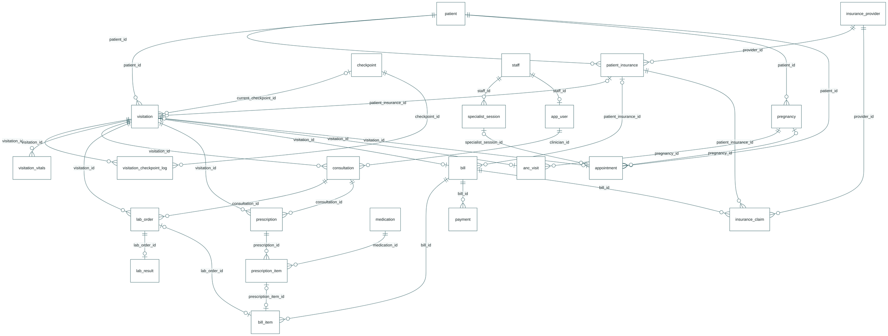
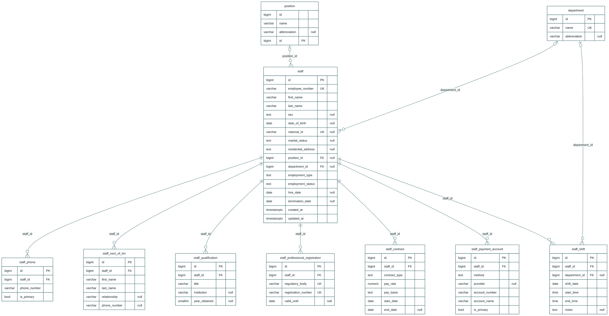
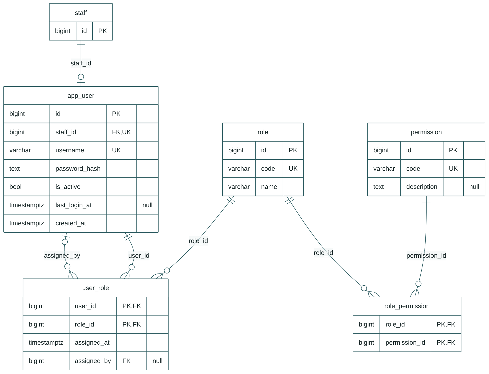
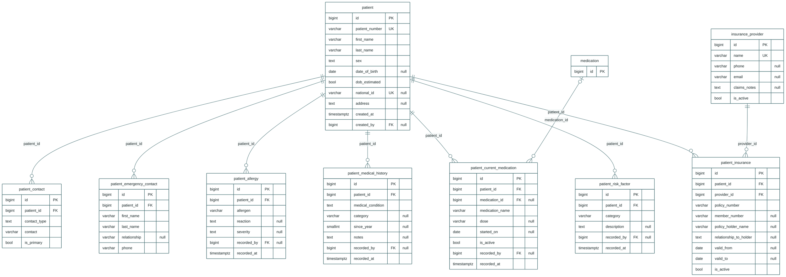
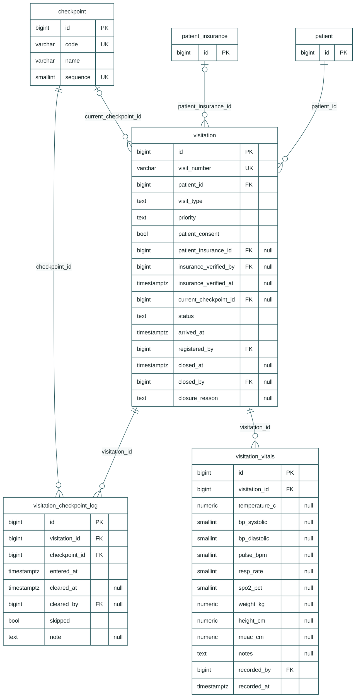
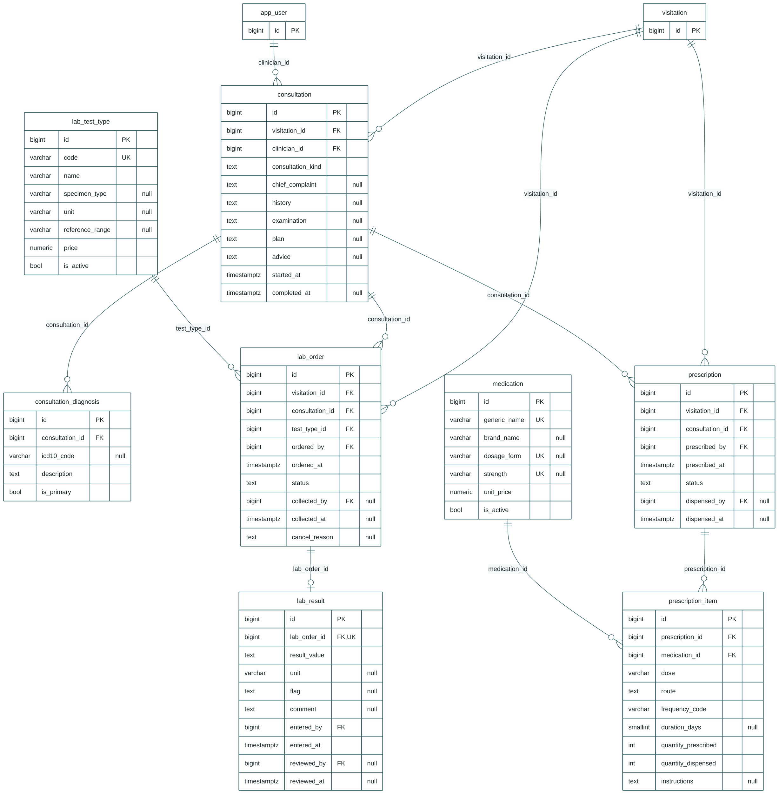
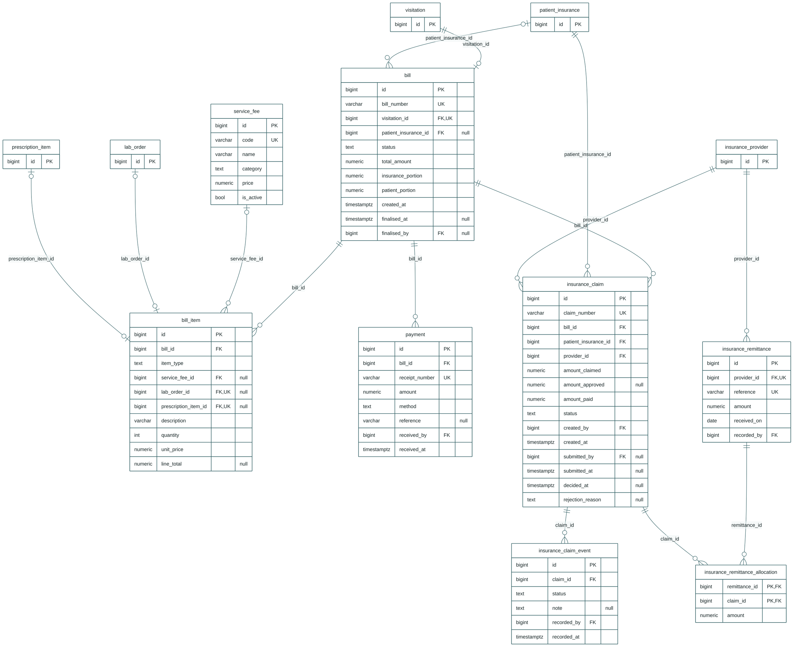
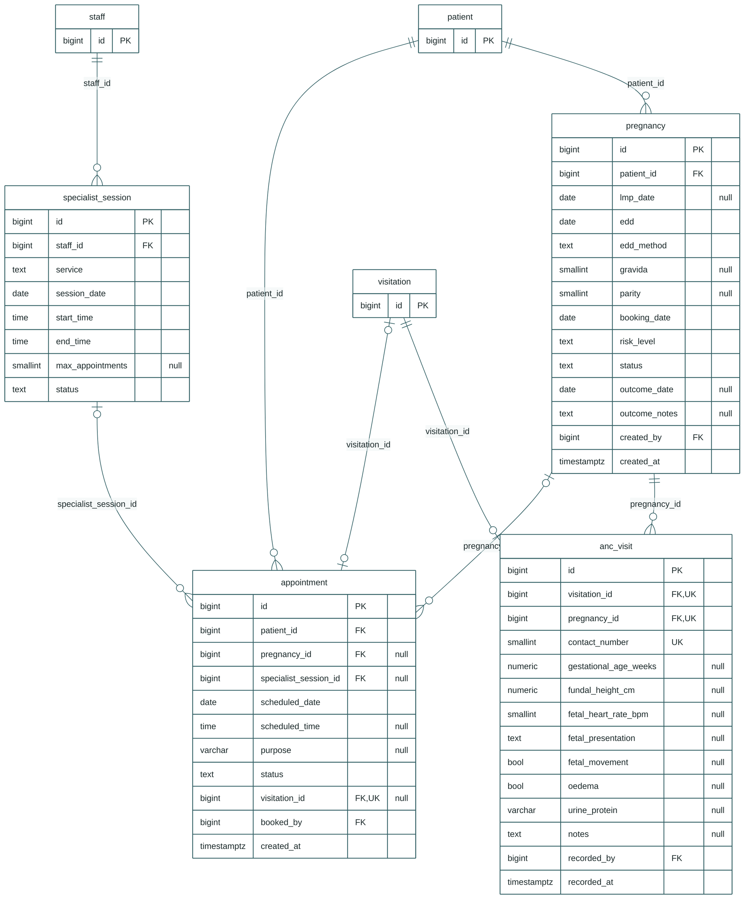

# TMC Clinic Data Model

Core clinical management system with the antenatal care extension, drawn from the PostgreSQL schema after it loaded and passed a full patient-journey test.

48 tables374 columns89 foreign keys6 reporting viewsPostgreSQL 16

[Overview](#overview) [Staff & organisation](#staff) [Access control](#access) [Patients](#patients) [Visit flow & queue](#visits) [Clinical](#clinical) [Billing & insurance claims](#billing) [ANC extension](#anc)

## Overview

core path

How a visit connects the patient, the clinical work, the bill and the ANC records. Attributes are in the sections below.

**||--o{** one to many

**||--o|** one to one (unique FK)

**|o--o{** optional parent (nullable FK)

**\*\_by** columns reference `app_user`; those lines are drawn only under Access control to keep diagrams readable

## Staff & organisation

10 tables

Employees, visiting specialists, HR records and rosters. Visiting ANC specialists are staff with employment type `visiting`.

Links out to: `"position"` (shown with their key only)

## Access control

5 tables

Logins and role-based permissions. A user can hold several roles through `user_role`.

Links out to: `staff` (shown with their key only)

## Patients

9 tables

The patient record created at reception, reused on every return visit.

Links out to: `medication` (shown with their key only)

## Visit flow & queue

4 tables

A visit moves through checkpoints. Each entry into a checkpoint is a log row, so revisits and skips are recorded. The queue is open visits grouped by current checkpoint.

Links out to: `patient`, `patient_insurance` (shown with their key only)

## Clinical

8 tables

Consultations, lab orders and results, and prescriptions. Order and prescription status is what shows as pending to the lab and pharmacy.

Links out to: `app_user`, `visitation` (shown with their key only)

## Billing & insurance claims

8 tables

One bill per visit, with lines that trace back to the fee, lab order or prescription item. Insured portions become claims; insurer remittances are allocated across claims.

Links out to: `insurance_provider`, `lab_order`, `patient_insurance`, `prescription_item`, `visitation` (shown with their key only)

## ANC extension

4 tables

Pregnancy episodes, ANC contact details (1:1 with a visit), specialist sessions and booked appointments. The general clinic tables do not depend on any of these.

Links out to: `patient`, `staff`, `visitation` (shown with their key only)

Generated from `clinic_schema.sql`. Views: v_visit_queue, v_visit_open_items, v_anc_active, v_anc_expected_deliveries_by_month, v_revenue_daily, v_claims_outstanding.
