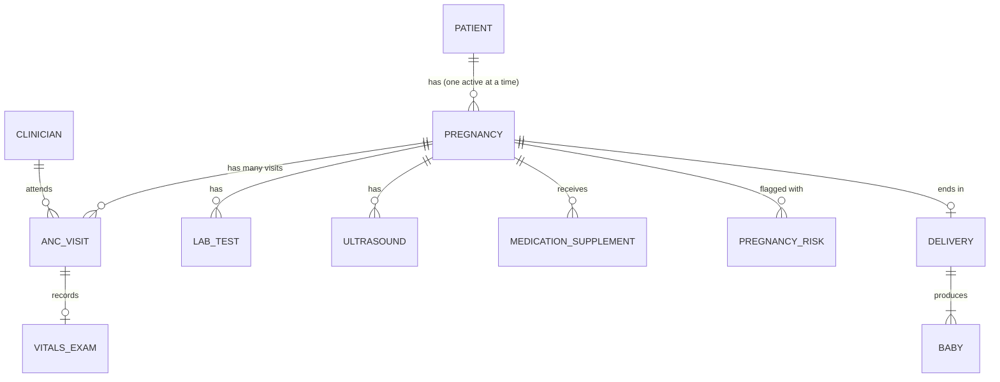

# ANC Clinic System: Data Model v2

Thanthwe Medical Centre (TMC) · PostgreSQL 15+ · reference implementation in `schema.sql` (41 tables, 5 reporting views, 4 trigger functions, seed data; tested end to end with sample data).

**Who this is for.** The three developers building the system, and anyone who needs to understand what the database stores and why. You can read it top to bottom (concepts first, then detail), or jump to a section from the contents.

**Contents**
1. What the system has to answer
2. The big idea: patient, pregnancy, visit
3. How to read the model (conventions)
4. A worked example: one woman's journey through the tables
5. The model at a glance (diagrams)
6. The tables, domain by domain
7. Rules the database enforces (and rules it does not)
8. Reports: how the questions get answered
9. Birth register indicators
10. Design decisions and the reasons behind them
11. Privacy and access
12. Building it: implementation notes for our stack
13. Source mapping (HR sheet, registration form, ERD v1)
14. Open questions and known gaps
15. Glossary
16. Change history
Appendix: full ERD source

---

## 1. What the system has to answer

The clinic's stated needs, in the manager's words, are to know:

1. **How many women are currently in antenatal care.**
2. **For each woman, her next visit day and her possible delivery day.**
3. **How many deliveries are expected per month.**
4. **Which doctors (clinicians) are available for antenatal visits.**
5. Plus clinical detail (vitals, labs, scans, supplements, risks, referrals, delivery, newborn) and the **monthly maternity register** counts (admissions, SVD, C-section, stillbirths, and so on).

A good data model makes these questions **simple queries**, not detective work. Most of the design choices below come from asking "what must be true in the data so that this question has one clear answer?"

---

## 2. The big idea: patient, pregnancy, visit

Three levels, each with a different lifetime:

| Level | Table | Lifetime | Example |
|---|---|---|---|
| **The woman** | `patient` | Exists once, for life | Mary Banda, file TMC-P0001 |
| **An episode of care** | `pregnancy` | One per pregnancy; a woman can have several over the years | Mary's 2026 pregnancy |
| **An event** | `anc_visit` (and labs, scans, supplements...) | Many per pregnancy | Her 20-week visit on 25 May |

**Why not keep everything on the patient?** Because the clinical facts belong to a *pregnancy*, not to the woman. Her expected delivery date, risk flags, lab results and delivery all describe one pregnancy. If those were stored on the woman, a second pregnancy would overwrite or mix with the first.

**What this buys us:**
- "Women currently in ANC" becomes: count pregnancies where `status = 'Active'`.
- "Expected deliveries in October" becomes: count active pregnancies whose `edd` falls in October.
- A returning woman keeps one patient record and gets a new pregnancy, with her earlier pregnancies visible in the history.

Everything else in the model hangs off these three levels.

---

## 3. How to read the model (conventions)

- **Primary key (PK).** Every table has an id column (`patient_id`, `visit_id`...) generated automatically by the database. Ids carry no meaning; they only identify a row.
- **Foreign key (FK).** A column that points at a row in another table (`anc_visit.pregnancy_id` points at `pregnancy`). It is how tables connect. The database refuses an FK value that doesn't exist.
- **One-to-many.** The most common relationship: one patient has many pregnancies; one pregnancy has many visits. The FK lives on the "many" side.
- **One-to-one / zero-or-one.** Enforced with a UNIQUE FK: one visit has at most one `vitals_exam`; one pregnancy has at most one `delivery`.
- **Lookup (reference) tables.** Small tables of allowed values that staff may need to extend (`risk_factor`, `lab_test_type`, `medication_item`...). Adding a new lab test is a new row, not a code change.
- **Fixed lists as CHECK constraints.** Short, stable lists (visit status, delivery mode) are enforced directly on the column, e.g. `status IN ('Scheduled','Attended','Missed','Rescheduled','Cancelled')`.
- **Required vs optional.** `NOT NULL` means required. A nullable column means "may be unknown".
- **Audit-style columns.** `recorded_by`, `performed_by`, `given_by`, `created_by` point at who did something. `created_at` / `updated_at` record when.
- **Generated columns.** `full_name` is computed by the database from first, middle and last name, so it can never disagree with them.
- **Dates and times.** `date` for calendar days, `timestamptz` (timestamp with time zone) for moments in time. Weekdays use ISO numbering: 1 = Monday ... 7 = Sunday.
- **Phone numbers and ids** are stored as **text**, never numbers, so leading zeros survive (`0881012124`).

---

## 4. A worked example: one woman's journey

This follows Mary Banda through the system, showing which rows get created. (Names and numbers are invented.)

| Step | What happens | Rows created or changed |
|---|---|---|
| 1. Registers at TMC | Clerk fills the registration form | `patient` (file no. TMC-P0001), `patient_contact` x2 (emergency contacts), `patient_condition` (answers to the checklist), `patient_allergy`, `patient_consent` (treatment, and SMS reminders if she agrees) |
| 2. Booking visit, 5 March | Midwife records her last menstrual period (LMP) as 5 January | `pregnancy` is created. The system defaults `edd` to LMP + 280 days = **12 October**; `edd_method` = LMP. Her gravida (number of pregnancies) and parity (previous births) are recorded. Previous births go into `obstetric_history` |
| 3. Visit is recorded | Weight, blood pressure, fundal height, fetal heart rate | `anc_visit` (status Attended, `attended_at` set) and one `vitals_exam` row |
| 4. Labs ordered | Haemoglobin, HIV, syphilis, malaria, blood group | `lab_test` rows, one per test, each pointing at a `lab_test_type` |
| 5. Hb comes back 9.4 g/dL | Anaemia | `lab_test` result entered. Midwife adds the flag `Anaemia` in `pregnancy_risk`. Because that flag is a "high-risk trigger", a trigger sets `pregnancy.risk_level` to **High** automatically |
| 6. Supplements | Iron/folic acid, SP (malaria prevention), tetanus vaccine | `medication_supplement` rows |
| 7. Next visit planned | `visit_schedule_rule` says contact 2 is at 20 weeks, so about 25 May | A new `anc_visit` with status **Scheduled**, a clinician and a time. `v_active_anc` now shows this as her next visit |
| 8. Reminder | Two days before, the nightly job texts her (she consented) | `reminder_log` row (queued, then sent/delivered/failed) |
| 9. Ultrasound at 20 weeks | Scan dates the pregnancy 6 days later than the LMP | `ultrasound` row. The midwife changes `pregnancy.edd` to 18 October and `edd_method` to Ultrasound; a trigger logs the change in `pregnancy_edd_revision` |
| 10. She misses the 30-week visit | Nobody comes | The visit's status becomes **Missed**. She appears in `v_missed_needing_followup`. Each tracing attempt (call, SMS, home visit) is a `missed_visit_followup` row. A new Scheduled visit takes her off the list |
| 11. Labour at TMC, 16 October | Admitted and delivers a live boy, 3.1 kg, at 39 weeks | `maternity_admission`, then `delivery` (mode SVD), `baby` (birth_outcome Live birth, weight 3100). The monthly register view counts all of this. The pregnancy's `status` is set to **Delivered**, which removes it from "women currently in ANC" and "expected deliveries" |
| 12. Discharge and postnatal check | Discharged home; comes back at one week | `maternity_admission` gets `discharge_at` and status Discharged; `postnatal_visit` row |

Notice that **nothing is typed twice** and **no counts are stored**. Every report number is calculated from these event rows.

---

## 5. The model at a glance

### 5.1 The spine (the tables every question passes through)

How to read it: `||--o{` means "exactly one on the left, zero or many on the right". `||--o|` means "one, and zero or one on the right".

### 5.2 The full set, in six domains

| Domain | Tables | Count |
|---|---|---|
| Reference / lookup | `department`, `job_position`, `insurance_provider`, `medical_condition`, `risk_factor`, `lab_test_type`, `medication_item`, `visit_schedule_rule` | 8 |
| Staff and HR | `staff`, `staff_contact`, `staff_qualification`, `staff_contract`, `staff_payment_account`, `clinician`, `clinician_availability`, `clinician_leave` | 8 |
| Users and audit | `app_user`, `audit_log` | 2 |
| Patient | `patient`, `patient_contact`, `patient_insurance`, `patient_condition`, `patient_allergy`, `patient_medication`, `patient_consent`, `obstetric_history` | 8 |
| Pregnancy and ANC care | `pregnancy`, `pregnancy_edd_revision`, `pregnancy_risk`, `anc_visit`, `vitals_exam`, `lab_test`, `ultrasound`, `medication_supplement`, `referral` | 9 |
| Delivery and postnatal | `maternity_admission`, `delivery`, `baby`, `postnatal_visit` | 4 |
| Outreach | `reminder_log`, `missed_visit_followup` | 2 |

The full diagram is in the Appendix, and the rendered ERD images (all tables, and an ANC-core view) were shared alongside this document.

---

## 6. The tables, domain by domain

Columns marked **(req)** are required. Only the columns that matter for understanding are listed; `schema.sql` is the full definition.

### 6.1 Patient domain (from the registration form)

| Table | What it holds | Key columns and notes |
|---|---|---|
| `patient` | The woman, once | `file_no` (unique clinic file number, req), `first_name` / `last_name` (req), `middle_name`, generated `full_name`, `date_of_birth` (req), `national_id` (unique), `marital_status`, `occupation`, `phone`, `email`, `village`, `traditional_authority`, `district`, `residential_address`, `other_information` (the form's "any other information"), `status` (Active / Archived) |
| `patient_contact` | Emergency contacts (the form has two) | `patient_id`, `name` (req), `relationship`, `phone`, `is_primary` |
| `patient_insurance` | Insurance policies | `provider_id` (-> `insurance_provider`), `policy_number`, `policy_owner_name`, `owner_relationship` (Self / Spouse / ...), validity dates. A woman can have several over time |
| `patient_condition` | One answer per item on the medical history checklist | Primary key is (`patient_id`, `condition_id`), so each condition is answered at most once per patient. `answer` = Yes / No / Unknown, `details` for the "please specify" items, `year_diagnosed` |
| `patient_allergy` | Allergies and drug reactions | `allergy_type` (Drug / Food / Environmental / Other), `allergen`, `reaction`, `severity` |
| `patient_medication` | Medicines she takes now | `medication_name`, `dose`, `frequency`, start/end dates |
| `patient_consent` | Consents given, with signature | `consent_type` (Treatment / SMS reminders / Data sharing / HIV testing), `granted`, `consent_date`, `signature_file` (a path or link to the scan), `witnessed_by`, `withdrawn_at` |
| `obstetric_history` | Earlier pregnancies, before this clinic | `pregnancy_year`, `gestation_weeks`, `outcome` (Live birth / Stillbirth / Miscarriage / Abortion / Ectopic / Neonatal death), `delivery_mode`, `birth_weight_g`, `complications` |
| `medical_condition` (lookup) | The checklist items: diabetes, hypertension, asthma, lung disease, TB, hepatitis, HIV/AIDS, mental health, autoimmune, neurological, other | `requires_details` marks the "please specify" items; `is_sensitive` marks the ones that need restricted access (HIV, mental health) |
| `insurance_provider` (lookup) | Insurer names | `name` (unique) |

**Why checklist answers are rows, not columns.** The form has 11 yes/no items. Eleven columns would need a schema change for every new condition and would be mostly empty. As rows, a new condition is one new lookup row.

### 6.2 Staff and HR domain (from the HR template)

| Table | What it holds | Key columns and notes |
|---|---|---|
| `staff` | Every employee, clinical or not | `employee_no` (unique, e.g. TMC/2025/E001), names, `date_of_birth`, `national_id`, `marital_status`, `phone`, `residential_address`, `department_id`, `position_id`, `employment_status` (Active / On leave / Suspended / Terminated), `hire_date`, `termination_date` |
| `staff_contact` | Next of kin | One row per person (the HR sheet crams two people into one cell) |
| `staff_qualification` | Qualifications | `qualification`, `institution`, `year_obtained`; a person can hold several |
| `staff_contract` | Employment terms and pay | `contract_type` (Full Time / Part Time / Casual / Locum / Volunteer), `pay_rate`, `pay_basis` (Monthly / Weekly / Daily / Hourly / Per shift), `currency` (MWK), start/end dates. Only **one open contract** per person |
| `staff_payment_account` | How the person is paid | `method` (Bank / Mobile money / Cash), `provider` (Airtel Money, TNM Mpamba, a bank), `account_number`, `account_name` |
| `clinician` | Marks a staff member as a clinician and adds professional details | Primary key **is** `staff_id` (one clinician profile per staff member). `clinician_type`, `specialty`, `licence_body`, `licence_no`, `runs_anc_clinic` |
| `clinician_availability` | Weekly ANC clinic slots | `day_of_week` (1-7), `start_time`, `end_time`, `max_patients`, `effective_from` / `effective_to` so a schedule can change over time |
| `clinician_leave` | Time away | `start_date`, `end_date`, `leave_type`, `reason` |
| `department`, `job_position` (lookups) | Where people work and what they do | `job_position.is_clinical` |

**Why `staff` and `clinician` are separate.** Not every employee sees patients (the HR sheet includes a cleaner). `staff` holds what every employee has; `clinician` adds what only clinical staff have. Visits, labs and referrals point at `clinician`, so a cleaner can never be recorded as the person who examined a patient.

**Why pay data is in its own tables.** `staff_contract` and `staff_payment_account` can be locked to HR and Finance roles while the rest of `staff` stays visible to clinic managers.

### 6.3 Users and audit

| Table | What it holds | Notes |
|---|---|---|
| `app_user` | A login account, linked one-to-one to a `staff` row | `username`, `password_hash` (never a plain password), `role` (Admin / Clinician / Nurse/Midwife / Lab / Reception / HR / Read-only), `is_active` |
| `audit_log` | A trail of who did what and when | `user_id`, `table_name`, `record_id`, `action` (INSERT / UPDATE / DELETE / VIEW / EXPORT), `old_values` and `new_values` (JSON), `changed_at` |

### 6.4 Pregnancy and ANC care (the clinical core)

| Table | What it holds | Key columns and notes |
|---|---|---|
| `pregnancy` | One episode of care | `patient_id`, `registered_date`, `lmp_date`, **`edd`** (req), `edd_method` (LMP / Ultrasound / Clinical), `gravida`, `parity`, **`status`** (Active / Delivered / Miscarriage / Abortion / Transferred out / Lost to follow-up), `status_date`, `risk_level` (Low / High), `primary_clinician_id`, `registration_source` (ANC booking / Labour ward walk-in / Referred in / Born before arrival) |
| `pregnancy_edd_revision` | History of every change to the expected delivery date | `previous_edd`, `new_edd`, `method`, `reason`, `revised_by`, `revised_at` |
| `pregnancy_risk` | Risk flags on a pregnancy | `risk_id` (-> `risk_factor`), `noted_date`, `resolved_date`, `notes`. Each risk appears once per pregnancy |
| `risk_factor` (lookup) | Catalogue of risks | `category`, `severity`, **`triggers_high_risk`**: if true, an open flag makes the pregnancy High risk |
| `anc_visit` | **Every** visit, planned and done | `clinician_id`, `visit_number` (ANC contact 1-8+), `visit_type` (Booking / Routine / Follow-up / Emergency), `scheduled_date`, `scheduled_time`, **`status`** (Scheduled / Attended / Missed / Rescheduled / Cancelled), `attended_at`, `rescheduled_from_visit_id`, `cancellation_reason`, `clinical_notes`, `plan` |
| `vitals_exam` | Measurements at a visit (zero or one per visit) | `weight_kg`, `height_cm`, `bp_systolic` / `bp_diastolic`, `pulse_bpm`, `temperature_c`, `muac_cm`, `fundal_height_cm`, `fetal_heart_rate`, `fetal_presentation`, `fetal_movement`, `urine_protein`, `urine_glucose`, `oedema`. Urine protein and blood pressure together are the key pre-eclampsia signals |
| `lab_test` | One test and its result | `test_type_id`, `visit_id` (optional), `ordered_by`, `performed_by` (a lab technologist), `status` (Ordered / Collected / Resulted / Cancelled), `test_date`, `resulted_date`, `result_numeric` or `result_text`, `interpretation` (Normal / Abnormal / Positive / Negative / Indeterminate) |
| `lab_test_type` (lookup) | Catalogue of tests | Haemoglobin, HIV, syphilis, malaria, blood group and Rh, urinalysis, random glucose, hepatitis B. `result_kind`, `unit`, `ref_low` / `ref_high`, `is_sensitive` |
| `ultrasound` | A scan | `scan_date`, `gest_age_weeks` / `gest_age_days`, `fetuses`, `presentation`, `placenta_position`, `amniotic_fluid`, `estimated_fetal_weight_g`, `edd_by_scan`, `used_to_revise_edd` |
| `medication_supplement` | What was given | `item_id` (-> `medication_item`), `dose`, `quantity`, `date_given`, `given_by`: iron/folate, SP for malaria prevention, tetanus vaccine, albendazole, calcium |
| `medication_item` (lookup) | Catalogue of items | `category` (Supplement / Malaria prevention / Vaccine / Anthelmintic / Antiretroviral / Other), `default_dose` |
| `referral` | Sent to another facility | `reason`, `urgency` (Routine / Urgent / Emergency), `referred_to`, `referral_date`, `status` (Sent / Attended / No show / Cancelled), `feedback`, `outcome`, `outcome_date` |
| `visit_schedule_rule` (lookup) | The recommended contact schedule (WHO's 8 contacts) | `contact_no`, `min_gest_weeks`, `target_gest_weeks`, `max_gest_weeks`. Used by the app to propose the next visit |

### 6.5 Delivery and postnatal

| Table | What it holds | Key columns and notes |
|---|---|---|
| `maternity_admission` | A ward stay (labour/delivery, antenatal ward or postnatal ward) | `admission_type`, `admitted_at`, `admission_source` (Self / ANC clinic / Referred in / Born before arrival), `reason`, `discharge_at`, **`discharge_status`** (Discharged / Referred out / Absconded / Died), `referral_id` (when referred out). Discharge date and status must be set together |
| `delivery` | The birth event (zero or one per pregnancy) | `delivery_datetime`, `gest_age_weeks`, **`mode`** (SVD / Caesarean / Vacuum extraction / Forceps / Breech / Other), `born_before_arrival`, `place_type` (TMC / Other facility / Home / En route), `attended_by`, `blood_loss_ml`, `uterine_rupture`, `complications`, `maternal_outcome` (Alive / Died), `maternal_death_cause` |
| `baby` | One row per baby born (twins = two rows) | `birth_order`, `sex`, `birth_weight_g`, `apgar_1min`, `apgar_5min`, **`birth_outcome`** (Live birth / Fresh stillbirth / Macerated stillbirth), `birth_asphyxia`, `date_of_death` and `cause_of_death` (for a live-born baby who later died), `feeding_plan` |
| `postnatal_visit` | Follow-up after delivery | `visit_date`, `mother_findings`, `baby_findings`, `family_planning_method` |

**Why `maternity_admission` is separate from `delivery`.** A stay and a birth are different events. A woman can be admitted to the antenatal ward and go home without delivering, and a stay can end in a referral. The register's Admission, Discharge and Ref out counts come from stays; the delivery counts come from births.

### 6.6 Outreach

| Table | What it holds | Notes |
|---|---|---|
| `reminder_log` | Each reminder message sent for a visit | `channel` (SMS / WhatsApp / Call), `phone_used`, `message_text`, `scheduled_send_at`, `sent_at`, `delivery_status` (Queued / Sent / Delivered / Failed), `provider_message_id`, `error`. Logging the number actually used matters, because patients change numbers |
| `missed_visit_followup` | Each attempt to trace a woman who missed a visit | `attempt_no`, `attempt_date`, `method` (Call / SMS / Home visit / Via contact person), `outcome` (Reached - rebooked / Reached - declined / Not reachable / Moved or transferred / Delivered elsewhere / Deceased), `new_visit_id` |

---

## 7. Rules the database enforces (and rules it does not)

### 7.1 Enforced by the database (cannot be broken by a bug in the app)

| Rule | How |
|---|---|
| A woman has **at most one Active pregnancy** | Partial unique index on `pregnancy(patient_id)` where status is Active |
| A **Scheduled** visit must have a clinician and a time | Check on `anc_visit` (the availability count depends on it) |
| An **Attended** visit must have `attended_at` | Check on `anc_visit` |
| An attended visit number (contact 1, 2, 3...) is used once per pregnancy | Partial unique index |
| One vitals record per visit; one delivery per pregnancy; one baby per `birth_order` per delivery | UNIQUE constraints |
| Blood pressure: systolic must be greater than diastolic; plausible ranges for weight, BP, Apgar (0-10), birth weight | CHECK constraints |
| Availability windows end after they start; leave ends on or after it starts; contracts end on or after they start | CHECK constraints |
| Only **one open contract** per staff member | Partial unique index |
| EDD must be after LMP (when LMP is known) | CHECK |
| A baby that died later must have been **live-born** | CHECK on `baby` |
| A birth "before arrival" must be at home or en route | CHECK on `delivery` |
| Discharge time and status are set together | CHECK on `maternity_admission` |
| Allowed values for every status and type column | CHECK constraints and lookup tables |
| Links between tables point at real rows | Foreign keys |

### 7.2 Automated by triggers

| Trigger | What it does |
|---|---|
| `set_updated_at` | Keeps `updated_at` correct on `staff`, `patient`, `pregnancy` and `anc_visit` |
| `default_edd` | If a pregnancy is created with an LMP but no EDD, sets EDD = LMP + 280 days (Naegele's rule) |
| `log_edd_revision` | Whenever `pregnancy.edd` changes, writes the old and new date and method to `pregnancy_edd_revision` |
| `refresh_risk_level` | After any change to `pregnancy_risk`, sets the pregnancy to **High** if it has any open flag whose risk factor "triggers high risk", otherwise **Low** |

### 7.3 NOT enforced yet (the application must handle it, or we add it)

| Rule | Why it matters |
|---|---|
| **Setting `pregnancy.status` to Delivered when a delivery is recorded** | Until the status changes, the woman still counts in "currently in ANC" and "expected deliveries". Recommended: set it in the same transaction as the delivery insert, or add a trigger |
| Only women who consented to SMS get reminders | The scheduler must check `patient_consent` before queueing a message |
| The reason and the user on an EDD revision | The trigger records the dates and method; the app should fill `reason` and `revised_by` |
| Manual overrides of `risk_level` | The trigger recalculates from flags and will overwrite a manual change. If clinicians need to override, add an override column |
| Scheduling a visit outside a clinician's availability, or on a day they are on leave | The `v_clinician_slot_availability` view shows what is open; the app must only offer those slots |
| Who may see which tables | Enforced by the app's roles (section 11) |

---

## 8. Reports: how the questions get answered

The five views are saved queries; nothing in them is stored, so they are always current.

| Question | Where the answer comes from |
|---|---|
| **Women currently in ANC** | `v_active_anc` lists every pregnancy with `status = 'Active'`: the woman, her file number and phone, `edd`, how many weeks pregnant she is today (`gest_weeks`), risk level, and her next visit |
| **Next visit for each woman** | In `v_active_anc`: the earliest **Scheduled** visit dated today or later. A scheduled visit is just an `anc_visit` row not yet attended, so there is no separate appointments table |
| **Possible delivery day** | `pregnancy.edd`. Stored (not computed on the fly) because a scan may revise it, and `edd_method` says which method produced it |
| **Expected deliveries per month** | `v_expected_deliveries_by_month`: active pregnancies grouped by the month of `edd`, with a high-risk count |
| **Clinician availability** | `v_clinician_slot_availability`: for the next 60 days, each clinician's weekly slots (`clinician_availability`), minus days on leave (`clinician_leave`), minus visits already booked in that window; shows `booked` and `slots_left` |
| **Missed visits needing follow-up** (bonus) | `v_missed_needing_followup`: women in an active pregnancy with a Missed visit and no later Scheduled one, with the number of tracing attempts so far |
| **Monthly maternity register** | `v_maternity_indicators_monthly`, described next |

---

## 9. Birth register indicators

The register's figures are **counted from events**, never typed in. The view `v_maternity_indicators_monthly` returns one row per month.

| Indicator | Meaning | Counted from |
|---|---|---|
| Admission | Women admitted to the maternity ward | `maternity_admission.admitted_at` |
| Discharge | **`discharge_home`**: women discharged home. **`discharge_all`**: every ward exit (home, referred out, absconded, died) | `discharge_status` / `discharge_at` |
| SVD | Spontaneous vaginal delivery | `delivery.mode = 'SVD'` |
| C-section | Caesarean | `mode = 'Caesarean'` |
| Breech | Breech delivery | `mode = 'Breech'` |
| V/extraction | Vacuum extraction | `mode = 'Vacuum extraction'` |
| Total birth | **`total_birth_babies`**: every baby born, live and still (twins add 2). **`total_birth_deliveries`**: mothers who gave birth (twins add 1) | `baby` / `delivery` |
| LBWT | Low birth weight, under 2,500 g | `baby.birth_weight_g` |
| NND | Neonatal death: live-born, died within 28 days of birth | `baby.date_of_death` |
| MSD / FSD | Macerated / fresh stillbirth | `baby.birth_outcome` |
| MD | Maternal death | `delivery.maternal_outcome = 'Died'` |
| R/uterus | Ruptured uterus | `delivery.uterine_rupture` |
| Asphyxia | Birth asphyxia | `baby.birth_asphyxia` |
| Ref out | Referred out to another facility | admission ended with status Referred out |
| BBA | Born before arrival | `delivery.born_before_arrival` |
| Twin | **`twin_sets`**: deliveries with two or more babies. **`twin_babies`**: babies born in those deliveries | `baby` per delivery |
| Premature | Born before 37 weeks | `delivery.gest_age_weeks` |

Example: 10 deliveries including one set of twins gives `total_birth_babies` = 11, `total_birth_deliveries` = 10, `twin_sets` = 1, `twin_babies` = 2.

**Counting variants.** For Discharge, Total birth and Twin, the view returns both versions, because the register's exact counting rule is still to be chosen. The unused columns can be dropped once decided. The abbreviations have been confirmed.

**Walk-in and born-before-arrival cases.** A woman who arrives in labour may never have booked for ANC. She still gets a `patient` and a `pregnancy` (with `registration_source` set to Labour ward walk-in or Born before arrival; the EDD is a clinical estimate), so every delivery follows the same chain and the register is complete.

---

## 10. Design decisions and the reasons behind them

| # | Decision | Reason | What we gave up |
|---|---|---|---|
| 1 | **Separate patient from pregnancy** | The woman exists once; clinical facts belong to an episode of care | One extra join in queries |
| 2 | **Store `edd`, don't compute it** | A scan can revise it, and the clinic needs the date actually in use. `edd_method` and the revision history keep the trail | The date must be kept in sync by the app when LMP changes |
| 3 | **One `anc_visit` table for scheduled and attended visits** | A planned visit and a completed one are the same thing at different stages; one status column tells them apart | Rows for visits that never happened (Missed, Cancelled) stay in the table; reports filter by status |
| 4 | **No `next_visit_date` column** | It would duplicate the visit rows and go stale. The next visit is the earliest future Scheduled visit | A small query instead of a column read |
| 5 | **`staff` + `clinician` instead of `doctor`** | The HR sheet covers non-clinical staff, and nurses and midwives also run ANC clinics | One more table |
| 6 | **Split HR into several tables** | One person has several next of kin, qualifications and contracts; pay data needs tighter access | More tables to manage on import |
| 7 | **Checklists as rows with lookups** | New conditions, risks, tests and medicines need no code change | Slightly more complex forms |
| 8 | **Register figures computed from events** | Numbers are traceable to individual women and babies, can't drift out of sync, and can be recomputed under a different counting rule | Heavy views may need tuning at scale |
| 9 | **A separate `maternity_admission` from `delivery`** | A ward stay and a birth are different events (a woman can be admitted and not deliver) | One more table |
| 10 | **Walk-in deliveries get a pregnancy record** | Keeps one uniform chain for every delivery | A walk-in pregnancy has an estimated EDD and little ANC history |
| 11 | **Fixed short lists as CHECK constraints, growing lists as lookup tables** | Stable lists stay simple and fast; lists staff edit stay flexible | Changing a CHECK list needs a migration |
| 12 | **Database-generated numeric ids; business identifiers kept separate** | Ids never change; `file_no` and `employee_no` can follow the clinic's own formats | Two identifiers per record |
| 13 | **Phone numbers and national ids as text** | Preserves leading zeros and letters (e.g. `0K316VDT`) | None worth noting |
| 14 | **Audit log kept in the database** | Needed for sensitive health data; also records views and exports | Must be written to by the app |
| 15 | **No cache layer in the first version** | Clinic-scale load; stale clinical data is a safety risk | Revisit if a measured slowdown appears |

---

## 11. Privacy and access

Health data is sensitive personal data. Confirm current obligations under Malawi's data protection law with a legal advisor. The model supports this in these ways:

- **Sensitivity flags.** `medical_condition.is_sensitive` (HIV, mental health) and `lab_test_type.is_sensitive` (HIV test) let the app hide these from roles that don't need them.
- **Pay data separated.** `staff_contract` and `staff_payment_account` are for HR and Finance only.
- **Audit trail.** `audit_log` can record who *viewed* or *exported* a record, not only who changed it. Use it for sensitive records.
- **SMS consent.** Reminders require the `SMS reminders` consent. Keep message text free of clinical detail ("You have an appointment at TMC on Monday at 9:00").
- **Passwords.** Only hashes are stored in `app_user.password_hash`.
- **Consider column-level encryption** for `national_id` and `account_number`.

A suggested starting point for who sees what (to be refined with the clinic):

| Area | Admin | Clinician | Nurse/Midwife | Lab | Reception | HR |
|---|---|---|---|---|---|---|
| Patient demographics | edit | view | edit | view | edit | no |
| Pregnancy, visits, vitals | view | edit | edit | view | schedule only | no |
| Lab tests and results | view | order, view | view | enter results | no | no |
| HIV / sensitive results | restricted | view | view | view | no | no |
| Delivery, baby, register | view | edit | edit | no | no | no |
| Staff records | edit | no | no | no | no | edit |
| Pay and payment accounts | no | no | no | no | no | edit |
| Audit log | view | no | no | no | no | no |

---

## 12. Building it: implementation notes for our stack

Our confirmed stack is Next.js (frontend), Laravel (backend) and PostgreSQL, with Laravel's own migration tooling.

- **`schema.sql` is the reference, migrations are the delivery.** Translate it into Laravel migrations in dependency order: reference tables, staff, users, patient, pregnancy and ANC care, delivery, outreach, then views and triggers.
- **Things the Laravel schema builder may not express directly.** The partial unique indexes (`WHERE status = 'Active'`, `WHERE end_date IS NULL`, and so on), CHECK constraints, triggers, the `gest_weeks` function and the views. Put these in raw SQL statements inside the migration (`DB::statement` or `DB::unprepared`). Generated columns such as `full_name` can use `storedAs`, but check the result against the reference.
- **Timestamps.** Laravel (Eloquent) can also manage `created_at` / `updated_at`. The database triggers keep `updated_at` correct even for changes made outside Laravel, so keep one source in charge and note it in the team's conventions.
- **Views are read-only.** Model them in Laravel as read-only models or query them directly.
- **Seed data.** Move the lookup data (departments, positions, conditions, risk factors, lab tests, medicines, visit schedule) into seeders.
- **Shared-table changes.** The team agreed shared-table migrations are announced in the team chat first and reviewed via CODEOWNERS. The tables most shared across features are `patient`, `staff`, `clinician`, `pregnancy`, `anc_visit`, and the lookups.
- **Suggested feature slices** (each developer owns one end to end, schema through UI), with the tables each would own:

| Slice | Tables |
|---|---|
| A. Registration and patient file | `patient`, `patient_contact`, `patient_insurance`, `patient_condition`, `patient_allergy`, `patient_medication`, `patient_consent`, `obstetric_history`, plus lookups |
| B. ANC visits and scheduling | `pregnancy`, `pregnancy_edd_revision`, `pregnancy_risk`, `anc_visit`, `vitals_exam`, `clinician_availability`, `clinician_leave`, `visit_schedule_rule`, `reminder_log`, `missed_visit_followup`, and the availability/missed-visit views |
| C. Labs, scans, delivery and reports | `lab_test`, `ultrasound`, `medication_supplement`, `referral`, `maternity_admission`, `delivery`, `baby`, `postnatal_visit`, and the register view |
| Foundation (do first, shared) | `staff` and HR tables, `clinician`, `app_user`, `audit_log`, `department`, `job_position` |

This is a suggestion: slice B depends on `patient` and `clinician`, so the foundation and the patient table need to exist first.

---

## 13. Source mapping

### 13.1 HR template

| Source column | Destination | Note |
|---|---|---|
| Employee ID | `staff.employee_no` | Format `TMC/2025/E001` |
| Full name | `staff.first_name / middle_name / last_name` | `full_name` is generated |
| DOB | `staff.date_of_birth` | |
| ID | `staff.national_id` | Unique |
| M Status | `staff.marital_status` | Source shows "M" |
| Phone number | `staff.phone` | |
| Next of Kin + 2nd Phone number | `staff_contact` | One row per person |
| Residential address | `staff.residential_address` | |
| DEPT | `staff.department_id` -> `department` | |
| Position | `staff.position_id` -> `job_position` | |
| Qualification | `staff_qualification` | |
| Contract + Rate | `staff_contract` | |
| Acct | `staff_payment_account` | |

### 13.2 Patient registration form

| Form section | Destination |
|---|---|
| Full name, DOB, phone, email, address | `patient` |
| "Contact information" | Same fields as phone, email and address |
| Medical history checklist | `patient_condition` -> `medical_condition` |
| Current medications | `patient_medication` |
| Reaction to medications, Allergies | `patient_allergy` |
| Any other information | `patient.other_information` |
| Emergency contact 1 and 2 | `patient_contact` |
| Insurance provider, policy number, policy owner | `patient_insurance` -> `insurance_provider` |
| Treatment consent, signature, date | `patient_consent` |

Added beyond the form: `file_no`, `national_id`, `marital_status`, `occupation`, `village`, `traditional_authority`, `district`.

### 13.3 ERD v1 to v2

Every v1 entity survives. `DOCTOR` became `staff` + `clinician`; `DOCTOR_AVAILABILITY` and `DOCTOR_LEAVE` became `clinician_availability` and `clinician_leave`; `MEDICATION_SUPPLEMENT`, `RISK_FACTOR`, `PREGNANCY_RISK`, `OBSTETRIC_HISTORY`, `REFERRAL`, `LAB_TEST`, `ULTRASOUND`, `VITALS_EXAM`, `DELIVERY`, `BABY` kept their roles with added columns. The entities v1 only named (`REMINDER_LOG`, `MISSED_VISIT_FOLLOWUP`, `VISIT_SCHEDULE_RULE`, `STAFF_USER`, `AUDIT_LOG`, `POSTNATAL_VISIT`) are now fully specified.

---

## 14. Open questions and known gaps

**Decisions needed from the clinic**
1. **Pay rate unit.** The HR sheet gives rates (15,000 and 4,000) without a unit. The schema requires a `pay_basis` (per shift, daily, monthly...). Which applies?
2. **One site or several?** The model assumes one site. If TMC will have more, add a `facility` table and a `facility_id` on staff, visits and availability. Cheaper now than later.
3. **Who runs ANC clinics?** `clinician.runs_anc_clinic` allows doctors, clinical officers and midwives to hold slots. Confirm which roles actually do.
4. **Slot model.** Capacity is a head count (`max_patients`) per availability window. If fixed time slots are wanted (say every 20 minutes), add a slot length and generate the slots.
5. **Register counting rules** for Discharge, Total birth and Twin (both variants are provided until decided).

**Known gaps in this version**
- The rules listed in section 7.3 are not yet enforced.
- `visit_schedule_rule` is seeded with exact weeks only (minimum = target = maximum for contacts 2 to 8). Real scheduling needs a tolerance window (for example plus or minus one week), to be agreed with the clinicians.
- Pregnancy status changes are not recorded as a history (only the latest status and date).
- Only the latest `risk_level` is kept; the history lives in `pregnancy_risk` (noted and resolved dates).

**Data quality issues in the HR template (for the import)**
- Two columns are both named "Phone number" (staff and next of kin).
- One next-of-kin cell holds two people and two phone numbers, so import needs a manual split.
- DOB `03/5/2002` is ambiguous (day/month or month/day); standardise to ISO dates.
- "M Status" = `M` is ambiguous; the schema uses full words.
- "Acct" holds a provider name (AirtelMoney), not an account number. Qualification is blank on all rows.
- Keep phone numbers as text.

---

## 15. Glossary

| Term | Meaning |
|---|---|
| **ANC** | Antenatal care: care of a woman during pregnancy |
| **LMP** | Last menstrual period: the first day of her last period, used to date the pregnancy |
| **EDD** | Expected (estimated) date of delivery. Naegele's rule: LMP + 280 days (40 weeks) |
| **Gestational age** | How far along the pregnancy is, in weeks and days |
| **Gravida / parity** | Number of pregnancies / number of previous births |
| **ANC contact** | A scheduled antenatal visit. WHO recommends 8 |
| **Fundal height** | Measurement from the pubic bone to the top of the womb; tracks growth |
| **Pre-eclampsia** | Dangerous high blood pressure in pregnancy, often with protein in the urine |
| **IPTp-SP** | Malaria prevention in pregnancy (sulfadoxine-pyrimethamine) |
| **TT / Td** | Tetanus toxoid vaccine |
| **MUAC** | Mid-upper arm circumference; a nutrition measure |
| **Apgar score** | A 0 to 10 newborn health score at 1 and 5 minutes |
| **SVD** | Spontaneous vaginal delivery |
| **BBA** | Born before arrival (at the facility) |
| **LBWT** | Low birth weight (under 2,500 g) |
| **NND** | Neonatal death (live-born baby dying within 28 days) |
| **FSD / MSD** | Fresh / macerated stillbirth |
| **PK / FK** | Primary key / foreign key |
| **CHECK constraint** | A rule on a column that the database enforces |
| **Trigger** | Code the database runs automatically when a row changes |
| **View** | A saved query that behaves like a read-only table |
| **Lookup table** | A small table of allowed values |

---

## 16. Change history

| Version | Summary |
|---|---|
| v1 | Initial ERD (patient, pregnancy, visit, doctor and availability, delivery, additions brainstormed) |
| v2 | Staff/clinician split and HR tables; registration form tables; consent (including SMS); EDD revision history; risk-level trigger; WHO contact schedule; user and audit tables; outreach tables |
| v2.1 | Birth register indicators: `maternity_admission`, richer `delivery` and `baby`, `v_maternity_indicators_monthly` with counting variants |
| v2.2 | This document rewritten as a full explanation of the model rather than a list of changes. No schema changes |

---

## Appendix: full ERD source (Mermaid)

```mermaid
erDiagram
    DEPARTMENT ||--o{ STAFF : has
    JOB_POSITION ||--o{ STAFF : classifies
    STAFF ||--o{ STAFF_CONTACT : "next of kin"
    STAFF ||--o{ STAFF_QUALIFICATION : holds
    STAFF ||--o{ STAFF_CONTRACT : "employed under"
    STAFF ||--o{ STAFF_PAYMENT_ACCOUNT : "paid to"
    STAFF ||--o| CLINICIAN : "may be"
    STAFF ||--o| APP_USER : "logs in as"
    APP_USER ||--o{ AUDIT_LOG : generates
    CLINICIAN ||--o{ CLINICIAN_AVAILABILITY : sets
    CLINICIAN ||--o{ CLINICIAN_LEAVE : takes
    CLINICIAN ||--o{ ANC_VISIT : attends

    PATIENT ||--o{ PATIENT_CONTACT : "emergency contacts"
    PATIENT ||--o{ PATIENT_INSURANCE : covered_by
    INSURANCE_PROVIDER ||--o{ PATIENT_INSURANCE : issues
    PATIENT ||--o{ PATIENT_CONDITION : reports
    MEDICAL_CONDITION ||--o{ PATIENT_CONDITION : defines
    PATIENT ||--o{ PATIENT_ALLERGY : has
    PATIENT ||--o{ PATIENT_MEDICATION : takes
    PATIENT ||--o{ PATIENT_CONSENT : gives
    PATIENT ||--o{ OBSTETRIC_HISTORY : has
    PATIENT ||--o{ PREGNANCY : has

    PREGNANCY ||--o{ PREGNANCY_EDD_REVISION : "EDD history"
    PREGNANCY ||--o{ PREGNANCY_RISK : flagged_with
    RISK_FACTOR ||--o{ PREGNANCY_RISK : classifies
    PREGNANCY ||--o{ ANC_VISIT : includes
    ANC_VISIT ||--o| VITALS_EXAM : records
    ANC_VISIT ||--o{ REMINDER_LOG : triggers
    ANC_VISIT ||--o{ MISSED_VISIT_FOLLOWUP : "traced by"
    PREGNANCY ||--o{ LAB_TEST : has
    LAB_TEST_TYPE ||--o{ LAB_TEST : defines
    PREGNANCY ||--o{ ULTRASOUND : has
    PREGNANCY ||--o{ MEDICATION_SUPPLEMENT : receives
    MEDICATION_ITEM ||--o{ MEDICATION_SUPPLEMENT : defines
    PREGNANCY ||--o{ REFERRAL : may_have
    PREGNANCY ||--o{ MATERNITY_ADMISSION : "admitted as"
    MATERNITY_ADMISSION ||--o| DELIVERY : "delivery during stay"
    REFERRAL ||--o| MATERNITY_ADMISSION : "ends stay"
    PREGNANCY ||--o| DELIVERY : ends_in
    DELIVERY ||--|{ BABY : produces
    DELIVERY ||--o{ POSTNATAL_VISIT : followed_by
```

`visit_schedule_rule` is a standalone lookup and has no relationships.
